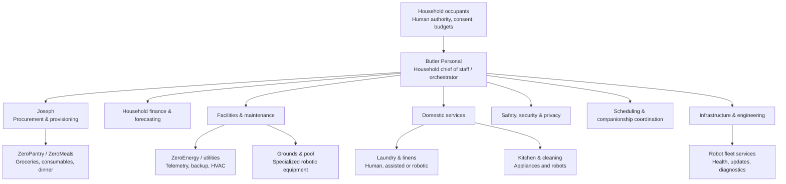

# ZeroHome proposed household organization

**Status:** Proposal, not an accepted architecture decision or implemented feature.  
**Scope:** ZeroCloud OS / ZeroHome, Butler Personal and domestic robotics.  
**Principle:** The household serves its occupants. Automation removes unwanted labor without removing the right to do meaningful domestic work together.

## Proposed organization chart

## Authority and departments

| Unit | Proposed responsibility | Explicit boundary |
| --- | --- | --- |
| Household occupants | Set policies, grant and revoke permissions, approve exceptional spending, reserve chores for people | Occupants retain final authority; shared-home permissions must respect other residents |
| Butler Personal | Route requests, coordinate agents, summarize exceptions, manage quiet/presence modes | No unrestricted financial, physical or private-data access |
| **Joseph: Procurement & Provisioning** | Detergent, groceries, meal orders, stock forecasts, approved substitutions, receipts and returns | Per-product authorization, total-cost caps, duplicate-order checks; no purchase beyond delegation |
| Household Finance | Budgets, utility bill forecasts, lifecycle reserves, expense reconciliation | Advisory by default; separate permissions for payments |
| Facilities & Maintenance | Work orders, HVAC, water, filters, appliance health, grounds and pool coordination | Safety-rated controllers and physical overrides independent of AI |
| Domestic Services | Cleaning, laundry, dishes, meal preparation and assistance | Human-first task reservations; no unwanted robot intervention |
| Safety, Security & Privacy | Access control, restricted zones, incident escalation, data minimization | No covert surveillance; security-critical functions fail safely |
| Scheduling & Connections | Shared availability, visitors, household tasks, quiet windows | Consent-scoped; no relationship labels or exposure of third-party calendars |
| Infrastructure & Engineering | Local services, backups, telemetry, robot updates, software maintenance | No automatic production deployment or privileged access without policy |

## Joseph's procurement lifecycle

1. Observe **verified or explicitly estimated** stock, consumption and pending deliveries.
2. Forecast replenishment need, accounting for delivery lead time and uncertainty.
3. Check approved products, retailers, unit prices, allergens/preferences, storage and existing orders.
4. Apply household budget, per-order cap, frequency cap, shipping/tax/tip total, and substitution rules.
5. Prepare a cart or place an order **only** if an authorized provider integration supports it and the household has explicitly delegated that exact class of purchase.
6. Track order state; distinguish ordered, shipped, delivered and physically received.
7. Reconcile receipts and inventory; preserve an auditable record and allow cancellation or intervention where supported.

Default purchasing mode: **draft for approval**. Autonomous checkout is an opt-in policy, not implied by account connection. Never store retailer credentials in agent prompts.

## Domestic participation policy

Every eligible task can be **automate**, **human**, **together**, **assist**, or **postpone**. A household member can reserve a task for human participation. ZeroHome must not infer that shared chores are unproductive or should be optimized away. Guest participation requires appropriate household consent. Emergency safety overrides are narrowly scoped and auditable.

## Operating model and technical boundaries

- Prefer local-first event buses, capability-scoped APIs, interoperable device protocols and deterministic schedulers. A language model is not the safety controller.
- Robot actions require independently enforced physical safety, collision protection, emergency stop, room permissions and clear disclosure of any remote supervision.
- Use idempotent task IDs, transaction records, inventory provenance, telemetry freshness and explicit offline/error states.
- Respect separate data boundaries between Butler Personal, business operations, ZeroConnections journals and third-party retailers.
- Essential heating, smoke/CO detection, emergency access and other safety-critical systems must remain safe without Butler, cloud connectivity or the primary server.
- Measure avoided interruptions, reliability, expense predictability and occupant satisfaction, **not** automation volume or household productivity scores.
- Provider integrations (including Walmart+, Shipt and restaurant services) require verification of current authorized APIs and checkout capabilities before implementation.

## Implementation roadmap

1. **Foundation:** household roles, task registry, consent/policy engine, audit log and manually entered inventory.
2. **Joseph MVP:** grocery/consumable budgets, replenishment forecasts, approved-product registry and cart drafts.
3. **Operational integrations:** supported local telemetry, appliance and utility monitoring, calendar-aware quiet windows.
4. **Authorized procurement:** provider-specific adapters, explicit checkout permissions, spend ceilings, reconciliation and rollback handling.
5. **Physical autonomy:** specialized robots first, then general-purpose manipulators only after robust safety and privacy validation.
6. **Digital twin:** household asset history, predictive maintenance and coordinated cross-department workflows.

## Design questions remaining

- Single household administrator versus shared/cooperative governance?
- Approval escalation when multiple occupants disagree?
- Default financial reserve and monthly caps per category?
- Agent naming, identities, reporting and audit presentation?
- Which physical robot operations can safely run unattended?

**Not implemented:** This document is a conceptual organization and roadmap, not evidence of functioning robots, purchases, utility integrations, or autonomous household control.
